# LabOps Insight

**An analytics platform and AI investigation agent for analytical / QC laboratories.** It turns scattered lab data (test results, instrument logs, deviations, SOPs) into a dashboard, a data-integrity review, ML forecasts, and an agent that answers questions with SQL you can inspect and procedures it cites.

[](https://github.com/JAIdamodharan/LabOpsInsight/actions/workflows/ci.yml)


[](https://lab-ops-insight.vercel.app)

> **All data is synthetic and anonymised.** Nothing here comes from, or represents, any real company's systems. Incidents and data defects were planted on purpose so every result can be checked against a known answer.

## The 60-second version

| | |
|---|---|
| **The problem** | In a lab, the answer to "why did turnaround slip?" or "can we trust this data?" sits in five places (results export, instrument logs, deviation tracker, SOP PDFs, email). Problems such as a drifting instrument hide inside monthly averages until dozens of results are affected. |
| **What I built** | A full-stack app: KPI **dashboard**, a rule-based **data-integrity review** (ALCOA+), **ML forecasts and a drift early-warning**, and a tool-using **LLM agent** with **RAG** over lab procedures. Also safe Excel upload, sign-in with roles, and a public Vercel demo with spending protection. |
| **How I know it works** | The dataset has three planted incidents and eight planted defects with exact counts. The app finds them, and tests assert it ([results](#results-you-can-verify)). |
| **Stack** | Python, FastAPI, DuckDB, pandas, scikit-learn, vanilla JavaScript + Chart.js (no build step), Groq / any OpenAI-compatible LLM, Vercel, GitHub Actions |
| **Size** | about 3,700 lines of Python app code, 1,100 lines of JavaScript, 3,400 lines of tests (**473 tests**, no API key needed), 41 commits |
| **Try it** | [Live demo](https://lab-ops-insight.vercel.app) (public, read-only) or [run it locally](#run-it) in a few commands |

## What it looks like

All screens use the built-in synthetic lab data. Try them live: **https://lab-ops-insight.vercel.app**

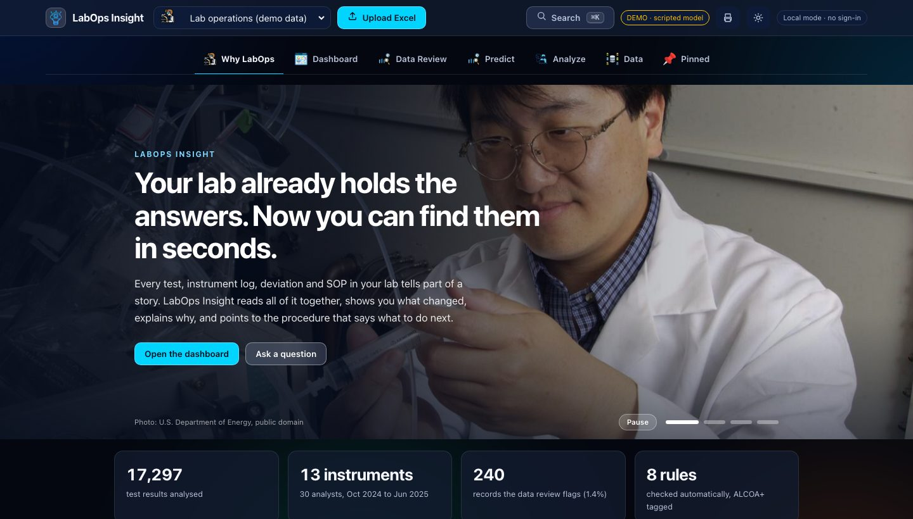
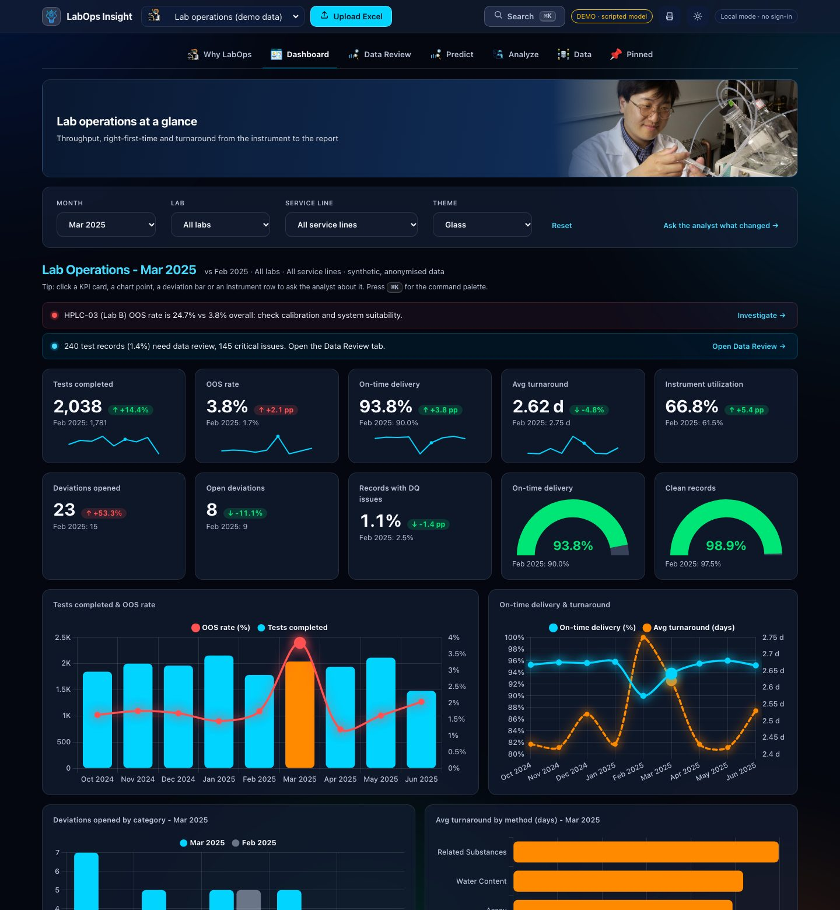

<details>
<summary><b>More screens: Data Review, Predict, Analyze, light mode</b></summary>

**Data Review**: rule-based checks tagged with ALCOA+ data-integrity principles.
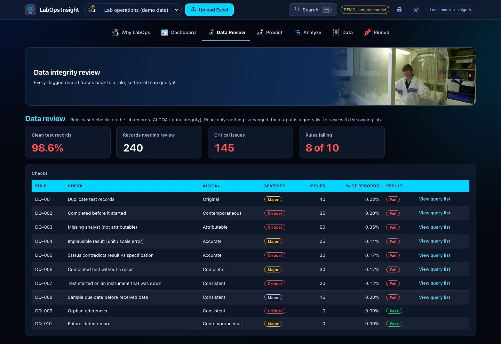

**Predict**: forecasts with ranges, and the drift early-warning chart that catches the March HPLC-03 incident.
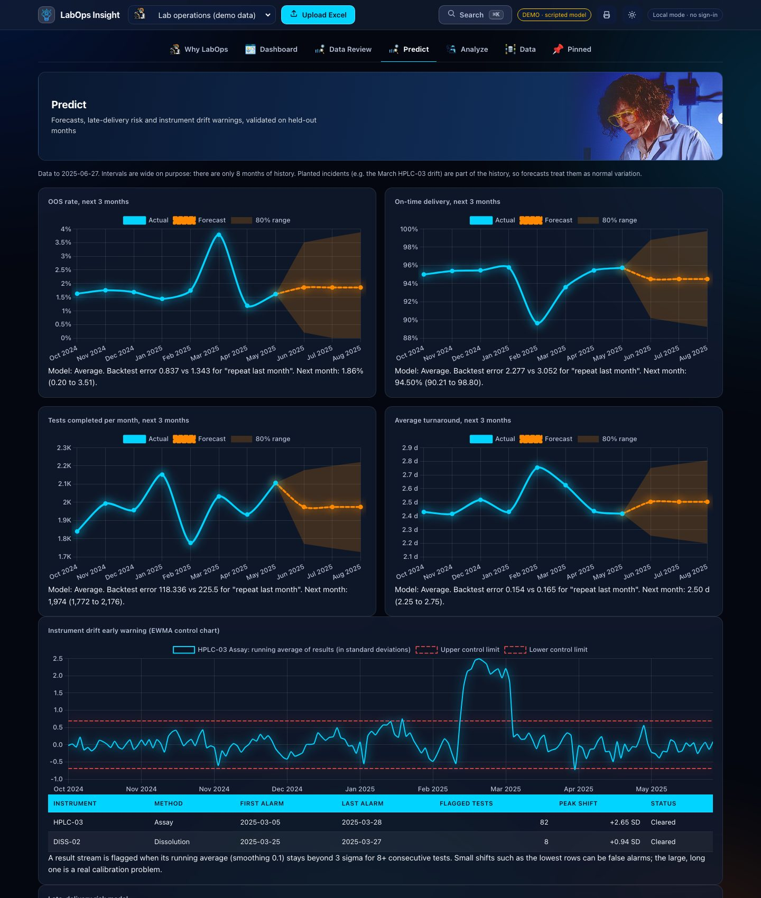

**Analyze**: the agent's SQL, chart, cited procedures and final answer.
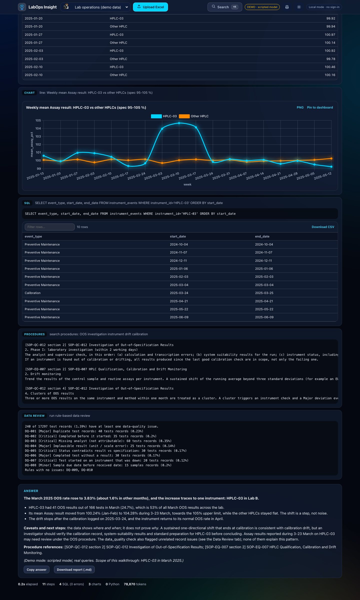

**Light mode**
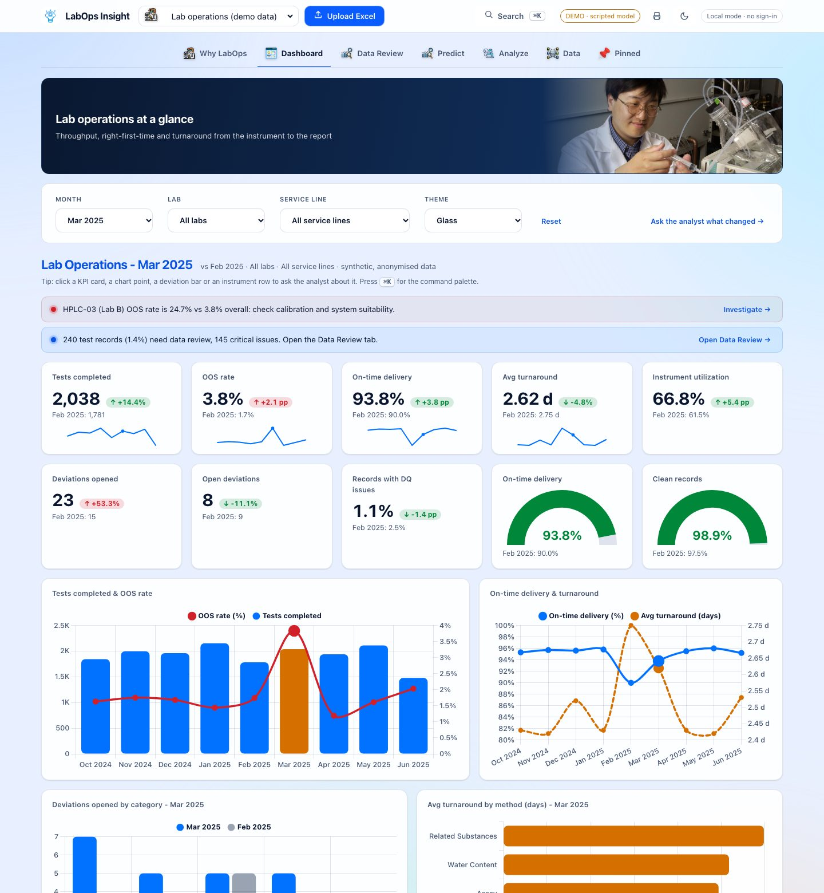

</details>

## Skills this project demonstrates

| Area | What is in the repo | Evidence |
|---|---|---|
| **Data analysis and SQL** | KPIs with month-over-month deltas, cohort and root-cause queries, parameterised slicers ([`dashboard.py`](analyst/dashboard.py), [`story.py`](analyst/story.py)) | Every dashboard number is checked against the planted ground truth in tests |
| **Data quality and integrity** | 10 lab rules tagged with ALCOA+ principles, plus generic checks for uploads ([`dq.py`](analyst/dq.py), [`profile.py`](analyst/profile.py)) | Finds all 8 planted defects with exact counts; a test proves a real OOS spike is *not* "cleaned away" |
| **Machine learning** | Forecasting, a late-delivery classifier and an EWMA control chart ([`predict.py`](analyst/predict.py)) | Validated on a **time split**: ROC AUC 0.981. A model that scored 0.46 (chance) was **removed, not shipped** |
| **LLM agents and tool use** | A loop with 6 tools, step and token budgets, a forced final answer, provider adapter with retries and fallback ([`agent.py`](analyst/agent.py), [`llm.py`](analyst/llm.py)) | 26-question benchmark graded against golden SQL, no LLM judge ([`eval/`](eval/)) |
| **RAG** | Local BM25 over eight SOPs with cited sections ([`rag.py`](analyst/rag.py)) | Retrieval tests; a test checks the SOP specification table equals the data |
| **Backend engineering** | FastAPI, server-sent events, cancellation that frees locks at once, visible rate-limit waits ([`server.py`](analyst/server.py)) | A regression test reproduces the disconnect-then-ask race |
| **Security** | scrypt passwords, hashed sessions, roles, audit log, CSP, safe Excel parsing, read-only SQL guardrail ([`auth.py`](analyst/auth.py), [`db.py`](analyst/db.py), [`ingest.py`](analyst/ingest.py)) | About 120 tests for auth and upload safety |
| **Testing and CI** | 473 tests with fake models (no key, no network), Node-run tests for the answer renderer, GitHub Actions with a secret scan ([`tests/`](tests/), [`ci.yml`](.github/workflows/ci.yml)) | CI badge above |
| **Deployment and cost control** | Vercel entrypoint, public read-only mode, daily budgets, cost caps, fail-closed fallback ([`api/`](api/), [`quota.py`](analyst/quota.py)) | [Deployment guide](docs/DEPLOY.md); tests for every limit |
| **Front end and accessibility** | No-build vanilla JS, light/dark, keyboard palette, reduced-motion support, contrast floors enforced by tests ([`static/`](analyst/static/)) | `tests/test_palette.py` fails the build if colours regress |
| **Communication** | A story page whose numbers come from the data, diagrams, deployment and architecture docs | You are reading it |

## Results you can verify

| Claim | How to check it |
|---|---|
| The HPLC-03 drift (3-23 Mar 2025) is found: the OOS rate on its Assay results is 33% vs 3% on other HPLCs | Dashboard, or `pytest tests/test_story.py` |
| The drift monitor raises its alarm on 5 Mar, two days after the shift starts, and shows it clearing after recalibration | Predict tab, or `pytest tests/test_predict.py` |
| All 8 planted data defects are found with exact counts (40 duplicates, 35 impossible dates, 60 missing analysts, ...) | Data Review tab, or `pytest tests/test_dq.py` |
| The late-delivery model reaches ROC AUC 0.981 on months it never saw (top 10% riskiest tests are late 43.5% of the time vs a 4.5% base rate) | Predict tab, or `pytest tests/test_predict.py` |
| A test-level OOS classifier scored 0.46 AUC and was dropped; the drift monitor replaced it | [Predict section](#predict-machine-learning) |
| The agent declines questions the data cannot answer (for example "how are sales?") instead of inventing an answer | Ask it on the live demo with a key, or `pytest tests/test_rag.py` |
| A first benchmark run with a free Groq model passed 16 of 26 questions; 9 of the 10 failures were requests blocked by a token cap, which I then reduced | [Known limitations](#known-limitations) |

## Engineering decisions and trade-offs

These are the choices I would walk an interviewer through, including the ones that did not work out.

| Decision | Why |
|---|---|
| **Guardrails in code, not in the prompt.** One read-only SELECT, 200 rows, 10 s timeout, external file access off | A model can be talked into anything; the database cannot. |
| **The model never invents numbers.** Charts take SQL and column names, and the code draws them; numbers in answers come from SQL, not from documents | Keeps every figure traceable. |
| **GxP-style honesty.** Report values as recorded, never silently drop or fix records, separate what the data shows from what it implies | Matches how a lab reviewer would expect an analyst to behave. |
| **Time-split validation, and deleting a model that did not work** | Shuffled splits flatter time-dependent data. Reporting 0.46 AUC honestly beats shipping a model that looks clever. |
| **Fewer tokens per call** (25 rows to the model, older results shortened, capped replies) | Free tiers limit tokens per minute. This targets latency and token-cap failures; I have not re-run the full benchmark since, so I make no claim about answer quality. |
| **Release locks on disconnect, show rate-limit waits, cancel for real** | Found by using the app: a Stop click left the server busy for 10 s. Fixed with an async stream and a regression test. |
| **Two run modes** (private with accounts; public read-only) from one codebase | A public link must not allow uploads or accounts; a team tool must. |
| **Spending protection that fails safe** | If a counter is down or a budget is used up, visitors still get a scripted answer; the paid key is never exposed. |
| **Deterministic evaluation** (golden SQL, no LLM judge) | An LLM grading an LLM hides regressions. |
| **No front-end build step** | Fewer moving parts; the page is readable in the browser and easy to deploy. |
| **A real OOS spike must not be "cleaned away".** A test asserts the HPLC-03 drift is not flagged as a data-quality issue | Data review must not hide genuine signals. |

## Architecture

Five diagrams, drawn as code (Mermaid), so GitHub renders them and they stay in sync with the repository. Click a diagram on GitHub to zoom.

### 1. System architecture

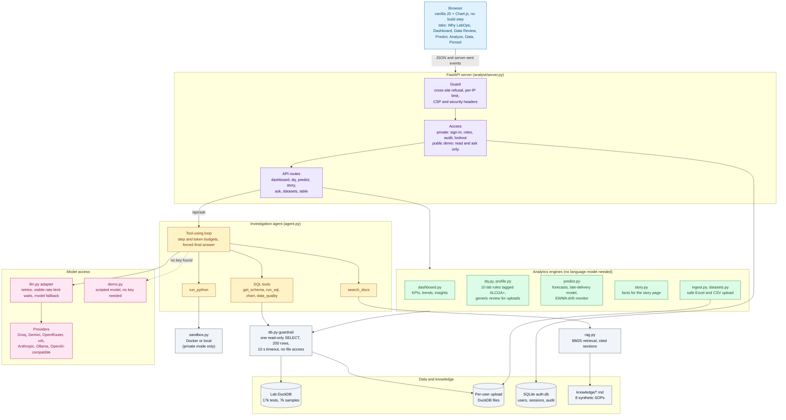

**How to read it.** Everything the browser asks goes through the Guard and the access layer first. Fixed questions (dashboard, data review, predictions, the story page) are answered by the analytics engines directly from the data and need no language model. Free-form questions go to the agent, which can only act through six tools; every database tool passes the read-only guardrail.

### 2. What happens when you ask a question

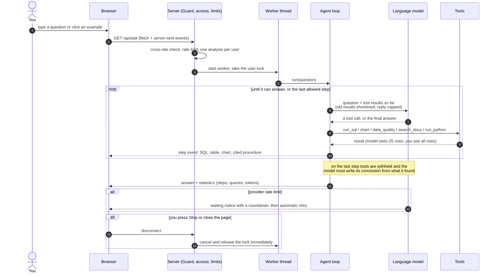

**How to read it.** The loop is the heart of the agent: the model asks for a tool, the tool runs under guardrails, the result goes back, and every step streams to your screen as it happens. Rate-limit waits are visible, and Stop really cancels the work.

### 3. Predictions: from raw tables to a trustworthy number

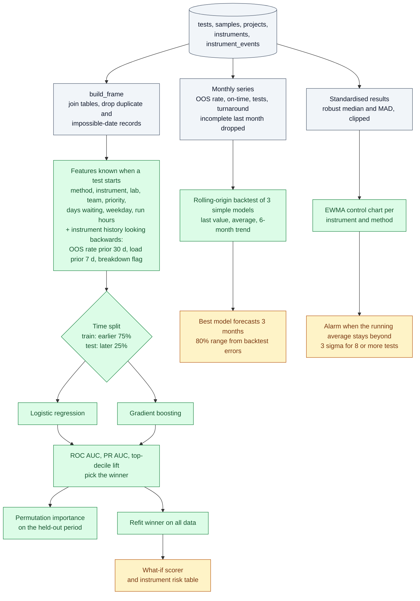

**How to read it.** Three independent tools share the same data. The risk model is judged on later months than it learned from, the forecasts are chosen by backtesting, and the drift monitor needs no training at all. A test-level OOS classifier was tried first and removed because it scored no better than chance on held-out months.

### 4. Safety layers (what protects the data and the user)

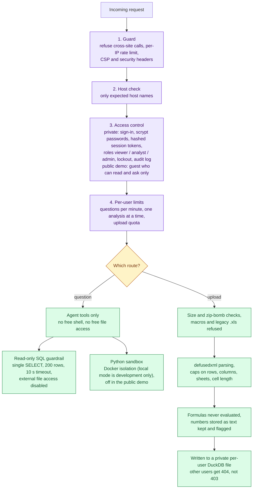

**How to read it.** Every request passes the same four gates. After that, questions and uploads each have their own checks, so even a confused or manipulated model cannot write to the database or touch files.

### 5. Two ways to run it

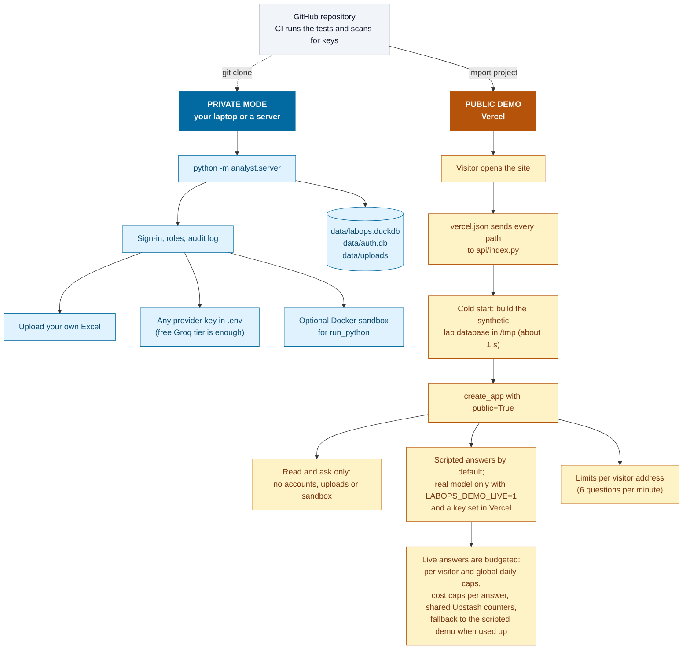

**How to read it.** The same code runs in both modes. The hosted demo is read only on purpose, because a public link must not allow uploads or accounts and a serverless disk is wiped between runs.

More detail on design decisions and the request lifecycle: [docs/ARCHITECTURE.md](docs/ARCHITECTURE.md).

## Run it

```bash
python3 -m venv .venv && source .venv/bin/activate
pip install -r requirements-dev.txt
python scripts/make_data.py                                # builds the synthetic lab database
cp .env.example .env                                       # optional: add a free GROQ_API_KEY for real answers
python -m analyst.server --demo --sandbox local            # http://127.0.0.1:8000
python -m pytest -q                                        # 473 tests, no key or network needed
```

`--demo` uses the built-in lab data and answers with a real model when a key is found in `.env`, otherwise with a scripted walkthrough (`--scripted` forces that). Without `--demo` the app starts in private mode with sign-in; the first visit creates the admin account.
Deploy your own copy to Vercel with Groq answering live, protected by daily budgets: see [docs/DEPLOY.md](docs/DEPLOY.md). Design notes: [docs/ARCHITECTURE.md](docs/ARCHITECTURE.md).

**Tabs:** *Why LabOps* (the story, numbers computed from the data), *Dashboard* (slicers, KPI cards with deltas, gauges, insights, trends, instrument table, OOS heatmap), *Data Review* (rule results and a downloadable query list), *Predict* (forecasts, late-delivery risk, drift warning), *Analyze* (the agent, with Copy answer and Download report), *Data* (table browser), *Pinned*. Light and dark mode, command palette (`Cmd/Ctrl+K`), print to PDF.

<a id="predict-machine-learning"></a>
## Deep dives

Each section opens on click.

<details>
<summary><b>What the data contains and what the project finds</b></summary>

`scripts/make_data.py` builds `data/labops.duckdb` (17k tests, 7k samples, 13 instruments, 30 analysts) and `data/ground_truth.json`.

| Planted root cause | What the dashboard / agent surfaces |
|---|---|
| HPLC-03 drifts +4.5 points on Assay results 3-23 Mar 2025 until recalibrated | OOS rate 3.8% vs ~1.6% baseline; HPLC-03 at 24.7%; weekly mean Assay jumps 100 -> 104.7% then recovers |
| LCMS-02 breaks down 10-24 Feb 2025; LC-MS work queues on LCMS-01 | On-time delivery 90% vs ~95%; Related Substances at 75%; wait before testing 0.8 -> 6 days |
| Six analysts joined Jan 2025 and raise most Documentation deviations from Apr | Documentation deviations ~4 -> ~17 per month; 87% against the new cohort; other categories flat |

| Planted data defect | Rule | Count (found exactly) |
|---|---|---|
| Duplicate test records | DQ-001 | 40 |
| Completed before started | DQ-002 | 35 |
| Missing analyst (not attributable) | DQ-003 | 60 |
| Unit / scale error | DQ-004 | 25 |
| Status contradicts result vs spec (20 OOS shown as Pass) | DQ-005 | 30 |
| Result missing | DQ-006 | 30 |
| Test started on an instrument that was down | DQ-007 | 20 |
| Sample due before received | DQ-008 | 15 |

</details>

<details>
<summary><b>Predict: machine learning details</b></summary>

Lab dataset only. Everything is trained on the lab data when the tab is first opened (a few seconds) and cached.

- **Forecasts** (OOS rate, on-time delivery, tests per month, turnaround): the best of three simple models (last value, average, 6-month linear trend), chosen by one-step rolling-origin backtesting, with 80% intervals taken from backtest errors. With about 8 months of history the intervals are wide, and the page says so.
- **Late-delivery risk model:** logistic regression vs gradient boosting (scikit-learn), validated on a **time split** (train on the earlier 75% of completions, test on the later 25%), reporting ROC AUC, precision-recall AUC and top-decile lift, plus permutation importance and a "what-if" scorer. Features only use information known when a test starts; instrument history looks strictly backwards.
- **Drift early warning:** an EWMA control chart per instrument and method on robustly standardised results. It flags the planted HPLC-03 Assay drift within days of its start (3 Mar) and shows it clearing after recalibration. A smaller, weaker alarm elsewhere can be a false alarm.
- **What did not work, and was removed:** a test-level OOS classifier scored ROC AUC about 0.46 on held-out months (no better than chance): OOS results are under 2% and almost all come from one instrument drift that cannot be learned from the earlier months. The drift monitor is the honest replacement.

</details>

<details>
<summary><b>Procedure documents (RAG) and the demo modes</b></summary>

- The agent has a `search_docs` tool over eight **synthetic** lab procedures in `analyst/knowledge/` (specification limits, OOS investigation, HPLC calibration and drift, instrument downtime, turnaround policy, deviations and CAPA, analyst training, ALCOA+). Retrieval is local BM25 over document sections (`analyst/rag.py`): no embeddings and no extra API. Passages are tagged `[SOP-QC-012 section 2]` and the model is told to cite them, to take numbers only from SQL, and to say so when the documents do not cover something. A test checks that the specification table in the documents matches the data. These are teaching documents, not any real company's SOPs.
- `--demo` now means "built-in lab data". If a key is found (`ANALYST_PROVIDER`, or the first of `GROQ_API_KEY`, `GEMINI_API_KEY`, `OPENROUTER_API_KEY`, ...) the demo answers with that real model, procedure search included. With no usable key it falls back to the scripted walkthrough (which also cites the procedures). Use `--demo --scripted` to force the scripted version and spend no quota.
- On the last allowed step the agent is told to stop investigating and write its answer, so a long investigation ends with a written conclusion instead of "max_steps".
- The "Why LabOps" hero slideshow uses wider crops of the same four photos (`hero-*.jpg`); sources and licences are as listed above.

</details>

<details>
<summary><b>Accounts, roles and security</b></summary>

The app asks you to sign in. **On first run it shows a setup screen that creates the first account, which becomes the admin**; after that, admins add everyone else
(Menu -> Manage users). Nothing is created for you, so there are no default passwords.
```bash
.venv/bin/python -m analyst.server --demo           # accounts on (default); data/auth.db is created next to the lab database
.venv/bin/python -m analyst.server --demo --no-auth # single-user local mode: no sign-in, everyone is an admin (also LABOPS_AUTH=0)
.venv/bin/python -m analyst.auth create-user alice --role analyst   # manage users from the terminal (password is prompted, never a flag)
.venv/bin/python -m analyst.auth list-users | set-password NAME | disable NAME | enable NAME
```

| Role | Can do |
|---|---|
| **viewer** | read the dashboard, data review, tables and profiles |
| **analyst** | + ask the analyst, upload datasets, delete **own** datasets |
| **admin** | + manage users and roles, read the audit log, see and delete **any** dataset |

Uploaded datasets are **private to their owner** (admins can see all); another user gets a 404, so even the existence of a dataset is not revealed. The UI hides what a role cannot do, but every route re-checks on the server.

**What is enforced** (all covered by `tests/test_auth_store.py`, `tests/test_auth_api.py`, `tests/test_static.py`):
- *Passwords:* scrypt with a per-user salt, constant-time compare, a policy (10+ chars, two kinds, not the username, not a common password), and a dummy hash for unknown users so timing does not reveal which usernames exist. Login errors are identical for "no such user" and "wrong password".
- *Sessions:* random 256-bit token in an `HttpOnly`, `SameSite=Strict` cookie (`Secure` over HTTPS); only the token's SHA-256 is stored server-side. 12 h idle / 7 day absolute expiry. Sessions are revoked on logout, password change (other devices), role change, disable and delete, and a new login replaces the browser's previous token.
- *Rate limiting:* per IP for every API call, per user for the API, plus tighter buckets for sign-in (and a lockout after 5 failures per IP+username, 25/hour per username across IPs), questions, uploads and password changes; one running analysis per user. Answers carry `Retry-After` and the UI shows a live countdown.
- *Cross-site and injection defences:* mutating requests need an `X-Requested-With` header, cross-site fetches are refused via `Sec-Fetch-Site`, Host allowlist against DNS rebinding, a strict Content-Security-Policy (no inline scripts, `script-src` limited to this origin and cdnjs), `nosniff`, frame denial, `no-store` on API responses, upload size enforced while streaming.
- *Admin safety:* the last active admin cannot be demoted, disabled or deleted; admins cannot lock themselves out; admin-set passwords must be changed at next sign-in.
- *Audit log* (admins only): sign-ins, failures, lockouts, logouts, password changes, uploads, deletes, role changes, denied actions and questions asked (length + short hash only: never passwords or question text).
- *Logout* clears the cookie, the session row, and the browser-side caches (recent questions, pins, loaded data).

**Honest limits.** The rate limiter and lockout are in memory and per process (a restart resets them; run one process, or move them to Redis for several). There is no MFA, no email-based password reset (an admin resets it), and no account self-registration. The server speaks plain HTTP on `127.0.0.1`: if you ever expose it beyond localhost, put it behind an HTTPS reverse proxy (the cookie then becomes `Secure` automatically; `X-Forwarded-For` is deliberately not trusted, so limits would key on the proxy's address until you configure that). Chart.js is loaded from cdnjs (allowed by the CSP); vendoring it with a Subresource Integrity hash would remove that dependency. This is hardening for a local analytics tool, not a certified system (no 21 CFR Part 11 e-signatures).

</details>

<details>
<summary><b>Use your own Excel data, providers and API keys</b></summary>

Click **Upload Excel** (or drop a file anywhere on the page). `.xlsx` and `.csv` are accepted; each sheet becomes a table and the first row is read
as the column headers. Headers are cleaned to `snake_case`, duplicates are suffixed, and the types are inferred. **Numbers stored as text are kept as text and flagged**,
not silently converted. Download the example workbook from the dialog to see the format; it contains realistic mistakes (duplicate rows, `N/A` in a numeric column, a price typo...).

| For an uploaded dataset | What you get | Needs a model? |
|---|---|---|
| **Overview** | row / column / completeness / duplicate KPIs, auto-generated charts (trend by month, average by category, distribution), per-column profile | no |
| **Data Review** | generic checks GQ-001..009 (missing values, duplicates, numbers stored as text, inconsistent spelling or spaces, outliers, negative quantities, future dates, constant columns) with severity, examples and a CSV export | no |
| **Data** | sortable, paged table browser | no |
| **Analyze** | the same agent, with a domain-neutral prompt and a `data_quality` tool that runs the generic review | **yes** (`--provider ollama` is free) |

Demo mode only scripts answers for the built-in lab data, and says so on uploads instead of faking it.

**Upload safety** (it is a local app, but uploads are untrusted input): `.xlsm`/`.xls` rejected; limits on size (15 MB, enforced while streaming), expanded size (zip bombs),
sheets (10), rows (200k), columns (100) and cells (3M); `defusedxml` guards against XML bombs; formulas are never evaluated; hidden sheets are skipped; every dataset
is its own read-only DuckDB file with external file access disabled; dataset ids are random hex and never used as paths; uploads and deletes need a custom header (blocks cross-site requests)
and a Host allowlist blocks DNS rebinding. Nothing leaves your computer.

`--demo` uses a scripted model that runs **real** SQL and data-quality checks for four investigations (OOS, on-time delivery,
deviations, data quality) and declines anything else. For free-form questions use a real model:

| Provider | Cost | Setup |
|---|---|---|
| `ollama` | free, local | `ollama pull llama3.2 && ollama serve`, then `--provider ollama` (a 3B model is weak; expect mistakes) |
| `groq` / `gemini` | free tiers | key from the provider, `export GROQ_API_KEY=...`, `--provider groq` |
| `anthropic` | paid per token | `export ANTHROPIC_API_KEY=...` |

```bash
.venv/bin/python -m analyst.cli --provider groq "Why was the OOS rate on HPLC-03 so high in March 2025?"
.venv/bin/python -m analyst.server --provider groq --sandbox local
.venv/bin/python -m eval.run_eval --provider groq          # 26-question benchmark
```
Default model names can be retired by providers; pass `--model` to override.

**Free-tier rate limits.** Free plans cap requests and tokens per minute. When a provider answers "429", the app waits (honouring `Retry-After`, up to 60 s, 4 retries) and *says so*: the terminal prints `note: the provider is rate limiting you ... waiting 12s before retry 1/4`, and the web page shows a live countdown instead of a frozen "Working…". Closing the page or pressing Stop cancels a wait immediately, and the server sends keepalive pings so long waits never drop the connection. To stay under token limits the model is sent at most 40 rows of any SQL result (you still see the whole table). If you hit limits often, pick a smaller or higher-limit model with `ANALYST_MODEL`, or wait a minute between questions. Do not press keys in the terminal while a command is running: Ctrl+C there cancels it.

**Automatic model fallback.** If you did not choose a model and the preset default is not available to your key, the app asks the provider which models your key can use, picks the best chat model (preferring large instruct models with tool calling), prints a one-line note saying which one, and carries on. A model you choose yourself (`--model` or `ANALYST_MODEL`) is never replaced silently.

**If a provider says "model not found"** (names get retired, or restricted per project), ask your own key what it can use, then set one:
```bash
.venv/bin/python -m analyst.llm models --provider groq
```
and put `ANALYST_MODEL=<name>` (and optionally `ANALYST_PROVIDER=groq`) in `.env`, or pass `--model <name>`.

**Keeping your API key (do this once).** `export KEY=...` only lasts for the one terminal window it was typed in, which is why a new tab says "not set". Instead:
```bash
cp .env.example .env && chmod 600 .env
```
then open `.env` in your editor and paste the key after `GROQ_API_KEY=` (no quotes needed). The app reads `.env` from the folder you start it in. Real shell variables still win over the file; only `*_API_KEY` names and a few app settings are loaded (never `PATH`, `LD_PRELOAD` and the like); empty values are ignored; and it warns if the file is readable by other users. `.env` is git-ignored; never paste a key into chat, an issue or a commit. Placeholder text like `paste-your-key-here` is rejected with an explanation.

</details>

<details>
<summary><b>Look and feel and interactions</b></summary>

- **Glass UI.** iOS-style frosted surfaces (`backdrop-filter` blur + saturation, specular edge highlights) over a slow-moving aurora backdrop, in light and dark mode. The dashboard has a **Glass** theme (default) plus the original Mint / Corporate themes. Respects `prefers-reduced-motion`, `prefers-reduced-transparency` and `prefers-contrast` (falls back to solid panels).
- **Colour.** No purple and no gradient accents: a solid bright accent (cyan with dark text in dark mode, blue with white text in light mode) and a 12-colour chart palette defined once as `--c1..--c12` in `style.css`. Dark-mode series colours are saturated and every one is at least 4.5:1 against its glass card; light-mode ones are deeper and at least 3:1. Lines glow in dark mode and tooltips are always dark with white text. `tests/test_palette.py` enforces all of this (no purple-range colour in CSS/JS/HTML or the logo images, contrast floors, distinguishable series, vivid dark colours), so a later edit that breaks it fails the build.
- **Loading states.** A full-screen splash (your logo, an animated bar and what it is doing) while the session and workspace load, a thin progress bar at the top while any request is in flight, a blurred overlay for slow views, skeleton cards while charts load, and a spinner with a lockout countdown on the sign-in button.
- **Icons.** The tab, dataset and empty-state icons are the PNGs in `analyst/static/icons/` (`dashboard`, `market-research`, `analyze`, `data`, `pinned`, `lab_operations`); swap a file to change an icon. Only the small utility glyphs (upload, search, print, light/dark) are inline SVG.
- **Logo.** `analyst/static/brand/` holds the logo made from a Canva design: `logo-mark.png` (header), `logo.png` / `logo-dark.png` (lockups for light / dark backgrounds), favicons and the app icon, plus the raw Canva export. `scripts/make_brand.py` regenerates them from a new Canva export.

### Interactions
| Do this | Get this |
|---|---|
| Click a **KPI card** | the analyst investigates why that metric changed |
| Click a **point or bar** in the volume / on-time charts | the whole dashboard jumps to that month |
| Click a **deviation bar**, a **turnaround bar** or an **instrument row** | the analyst investigates it |
| `Cmd/Ctrl + K` | command palette: jump to tabs, switch dataset or month, change theme, upload, or type a question |
| `/` | focus the question box from anywhere |
| Arrow keys on the tab bar | move between tabs |

KPI numbers count up, cards carry sparklines with the selected month marked, and a soft highlight follows the cursor over glass cards.
In demo mode every scripted answer states its fixed scope (e.g. "HPLC-03 in March 2025") and questions outside it are declined rather than answered with the wrong story.

</details>

<details>
<summary><b>Sample datasets for testing uploads</b></summary>

```bash
.venv/bin/python scripts/make_datasets.py
```

writes 15 synthetic, anonymised files to `sample_data/` (stability study, HPLC run log, sales, HR attrition, clinical vitals, inventory with expiry dates, balance calibration, support tickets, bioassay plates, environmental monitoring, batch release, deviations/CAPA, a deliberately messy file, a 60,000-row sensor CSV, and an 80-column wide file). Upload them with **Upload Excel**. A test checks that every file ingests cleanly.

</details>

## Known limitations

Stated plainly, because knowing the edges of your own work matters.

- The built-in data is synthetic: it demonstrates method, not results on real lab data. Uploaded workbooks get the generic Overview / Data Review, but the lab dashboard, the lab rules (DQ-001..010) and the scripted demo are specific to the built-in lab schema; mapping an arbitrary LIMS export onto them would need a column-mapping step that does not exist yet.
- Uploads are stored unencrypted under `data/uploads`. Each upload is private to the user who made it, but the files are readable by anyone with access to the server's disk.
- Excel reading: formulas show their last saved value (a formula that was never calculated shows blank); merged cells keep only their top-left value; the first non-empty row is always the header; dates stored as text stay text.
- DQ-004 only catches scale errors that push a result beyond 3x the upper spec limit; near-zero values slip through.
- "Utilization" assumes 20 available hours per weekday per instrument; real utilization needs scheduled-time and downtime data.
- The benchmark has not been run in full with a real model. A first run on Groq (`openai/gpt-oss-120b`) passed 16 of 26 questions; 9 of the 10 failures were requests that never completed because of the free tier's 8,000 tokens-per-minute cap (since reduced by sending fewer tokens per call), so they say little about answer quality. Run `eval.run_eval` and record your numbers below.
- The Docker sandbox path is implemented and unit-tested but its isolation test needs a running Docker daemon.
- Not validated for regulated (GxP / 21 CFR Part 11) use. There is sign-in, roles and an audit log, but no electronic signatures, validation documentation or change control.
- The hosted Vercel demo is public and read only by design, and its rate limits are per function instance, not global (see [docs/DEPLOY.md](docs/DEPLOY.md)).

## Repository layout

```
analyst/        the app: agent, DB guardrails, charts, dashboard, data review (dq.py, profile.py), safe ingest, auth and roles,
                predictions (predict.py), retrieval (rag.py + knowledge/), story page, LLM adapter, server and UI (static/)
api/            Vercel entrypoint for the public demo
docs/           DEPLOY.md and ARCHITECTURE.md
eval/           benchmark (26 questions, graded against golden SQL)
sandbox/        Docker image for the optional Python tool
sample_data/    15 synthetic workbooks for trying uploads
scripts/        data and asset generators
tests/          473 tests
```

## Benchmark results

| Model | Accuracy (26 q) | Cost / correct answer | Median latency |
|---|---|---|---|
| `openai/gpt-oss-120b` on Groq, first partial run | 16 / 26 (9 failures caused by the token cap) | free | about 30 s |
| (run `python -m eval.run_eval --provider ...`) | | | |

## Image credits

Banner photos are from Wikimedia Commons and are in the public domain or CC0 (no attribution required; credited here anyway):

- `instrument-scientist.jpg` and `hero-instrument.jpg`: [U.S. Department of Energy - Science - 408 041 001](https://commons.wikimedia.org/wiki/File:U.S._Department_of_Energy_-_Science_-_408_041_001_(9788226824).jpg), public domain.
- `clean-lab.jpg`: [U.S. Department of Energy - Science - 395 006 004](https://commons.wikimedia.org/wiki/File:U.S._Department_of_Energy_-_Science_-_395_006_004_(9735099945).jpg), public domain.
- `glass-flasks.jpg`: [Birnenkolben.jpg](https://commons.wikimedia.org/wiki/File:Birnenkolben.jpg), CC0.
- `analyst-instrument.jpg`: [U.S. Department of Energy - Science - 395 014 001](https://commons.wikimedia.org/wiki/File:U.S._Department_of_Energy_-_Science_-_395_014_001_(10293874364).jpg), public domain (cropped).

## License

MIT, see [LICENSE](LICENSE). The photographs are separate works (public domain or CC0), credited above. All data in the project is synthetic.
